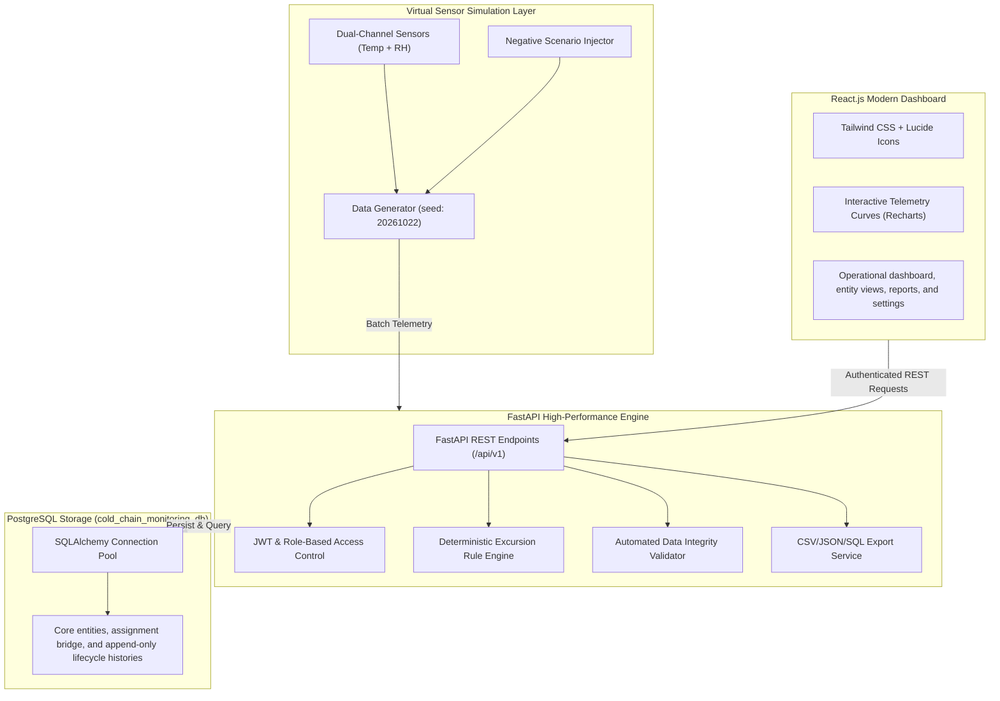

# Cold Chain Monitoring System - Architecture Document

## System Overview

The Cold Chain Monitoring System is a mission-critical platform providing continuous end-to-end environmental surveillance, excursion detection, chain-of-custody tracking, and regulatory compliance for temperature-sensitive pharmaceuticals, biologics, and cellular therapies.

## Security & Role-Based Access Control (RBAC)

Five operational roles are enforced server-side:
1. **Plant Operator**: View active shipments, monitor live telemetries, acknowledge real-time alarms.
2. **Maintenance Engineer**: Record sensor calibration outcomes and maintenance notes.
3. **Quality Engineer**: Define threshold policies, review excursions, and manage corrective actions (CAPA).
4. **Production Planner**: Schedule shipments, assign containers and products, plan route waypoints.
5. **OT/IT Administrator**: Manage user accounts and system access.
