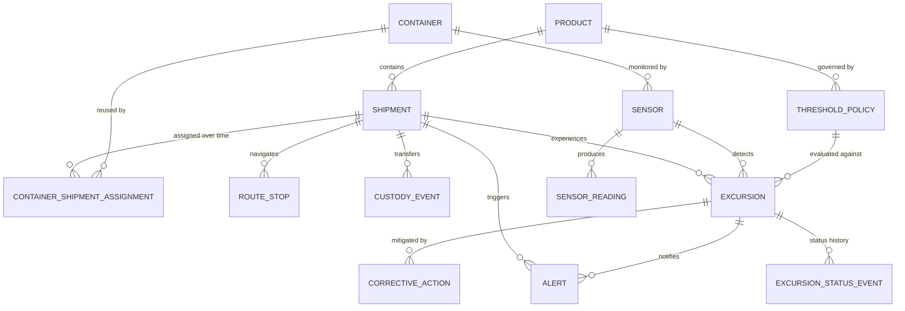

# Database Schema & Entity Relationships

## Relational Architecture Overview

---

## Entity Cardinalities & Foreign Keys

1. **Product (`products`)**
   - One-to-Many with `shipments` (via `shipments.product_id`)
   - One-to-Many with `threshold_policies` (via `threshold_policies.product_id`)

2. **Shipment (`shipments`)**
   - Many-to-One with `products` (`product_id`)
   - Many-to-Many with `containers` over time via `container_shipment_assignments`; `containers.assigned_shipment_id` is the current assignment only
   - One-to-Many with `route_stops` (`shipment_id`)
   - One-to-Many with `custody_events` (`shipment_id`)
   - One-to-Many with `excursions` (`shipment_id`)
   - One-to-Many with `alerts` (`shipment_id`)

3. **Container (`containers`)**
   - Many-to-Many with `shipments` over time via `container_shipment_assignments`
   - One-to-Many with `sensors` (`assigned_container_id`)

4. **Sensor (`sensors`)**
   - Many-to-One with `containers` (`assigned_container_id`)
   - One-to-Many with `sensor_readings` (`sensor_id`)
   - One-to-Many with `excursions` (`sensor_id`)
   - One-to-Many with `alerts` (`sensor_id`)

5. **SensorReading (`sensor_readings`)**
   - Many-to-One with `sensors` (`sensor_id`)
   - Many-to-One with `shipments` (`shipment_id`)
   - High-throughput telemetry table indexed on `(sensor_id, timestamp)` and `(shipment_id, timestamp)`
   - Unique constraint on `(sensor_id, timestamp)` prevents duplicate samples
   - Anomaly provenance is stored separately in `issue_type`, `ground_truth_label`, and `source_reading_id`

6. **RouteStop (`route_stops`)**
   - Many-to-One with `shipments` (`shipment_id`)
   - Composite unique constraint on `(shipment_id, stop_sequence)`

7. **ThresholdPolicy (`threshold_policies`)**
   - Many-to-One with `products` (`product_id`)
   - One-to-Many with `excursions` (`policy_id`)

8. **Excursion (`excursions`)**
   - Many-to-One with `shipments` (`shipment_id`)
   - Many-to-One with `sensors` (`sensor_id`)
   - Many-to-One with `threshold_policies` (`policy_id`)
   - One-to-Many with `corrective_actions` (`excursion_id`)
   - One-to-Many with `alerts` (`excursion_id`)

9. **CustodyEvent (`custody_events`)**
   - Many-to-One with `shipments` (`shipment_id`)
   - Ordered chronologically by `event_timestamp`

10. **CorrectiveAction (`corrective_actions`)**
    - Many-to-One with `excursions` (`excursion_id`)
    - Tracks remediation status: `OPEN`, `ACKNOWLEDGED`, `IN_PROGRESS`, `RESOLVED`, `CLOSED`

11. **ContainerShipmentAssignment (`container_shipment_assignments`)**
    - Composite primary key (`container_id`, `shipment_id`)
    - Many-to-Many bridge with `assigned_at` and `released_at` for shipment time validation

12. **ExcursionStatusEvent (`excursion_status_events`)**
    - Many-to-One with `excursions` (`excursion_id`)
    - Append-only record of each excursion status transition, actor, note, and timestamp

13. **SensorCalibrationEvent (`sensor_calibration_events`)**
    - Many-to-One with `sensors` (`sensor_id`)
    - Preserves each calibration status and certificate date change

14. **CorrectiveActionStatusEvent (`corrective_action_status_events`)**
    - Many-to-One with `corrective_actions` (`action_id`)
    - Append-only CAPA lifecycle status history with actor and note

## Effective policies and anomaly provenance

Threshold policies are selected by product, active status, and the reading timestamp within `effective_start` / `effective_end`. Excursions reference the exact policy used. Deliberate anomaly labels and original source references are retained on affected records; runtime evaluation does not use those labels as model inputs.
